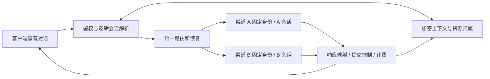

# 2026-11-15 无感渠道切换、身份隔离及原始缺陷修复：源码实施方案

状态：实施前设计基线；后续已获用户授权修改源码。实际交付、验证与未覆盖能力见[实施验收](2026-11-managed-recovery-implementation.md)，不能将下文拟议能力全部当作已实现。生产配置未修改。

本方案承接用户最新要求：客户端继续同一段对话，RenewAPI 在内部切换渠道；每渠道独立配置设备、安装 ID。它更新此前[会话设计](2026-11-channel-identity-session-design.md)中“首批不保存全量聊天历史”的建议。配套架构草案见 [ADR-023](../decisions/023-managed-conversation-recovery.md)。

## 1. 交付目标和已经确认的原因

推荐实现 **每渠道固定身份 + 网关托管对话上下文 + 能力驱动路由 + 统一恢复协调器**。客户端无需新增 header、改工具调用格式或手工新建对话，即可在可恢复的请求上完成切换。

| 已确认问题 | 现状证据 | 本次修改结果 |
| --- | --- | --- |
| 定价按钮看不见，顶部保存不含当前编辑 | 1600×900 浏览器中编辑器更新按钮 y≈1126，外卡底部≈847 且 overflow hidden；顶部直接提交父表单 | 编辑器正文滚动、保存操作常驻；所有保存入口提交同一份经过验证的完整快照 |
| namespace 非 function 本地 400 | codex 前缀默认归一化到 Chat；`responses_bridge_tools.go` 仅允许 namespace 内 function；线上三次对应错误为单次本地失败，未发送上游 | 请求能力先于默认协议；优先兼容的原生 Responses，转换不可表达时换候选，不误判合法请求为 malformed |
| 各渠道共用身份 | 当前全局 `force_global` 覆盖安装 ID、Claude 设备和 session；合成请求已复现不同调用者合并 | 渠道身份持久独立，逻辑会话按渠道/凭据投影，尝试间不串状态 |
| 跨渠道只清引用，不能保证保留上下文 | encrypted scrub helper 会删 previous_response_id，而不补父历史；线上对应开关开启 | 恢复前证明历史完整，再重建目标渠道请求；所有重试入口统一裁决 |
| WS 历史不能跨连接恢复 | `responsesWSHistory` 只在当前连接有限保存 input+output；HTTP 无统一持久上下文 | HTTP、SSE、WS 共用租户隔离的上下文存储和恢复服务 |

错误日志没有保存被拒绝子工具的确切类型；custom 是能精确复现错误的合成样例，不把它冒充线上原始请求。原生预检通过也不证明 #267 的第三方上游一定支持该工具，实施时需要在测试环境做真实能力验证。

线上目前 37 条启用渠道全部指向自定义地址：13 条 OpenAI、24 条 Anthropic，无 type57 原生 Codex。当前优先修中转链路、身份和会话；原生 OAuth 并发刷新放到独立阶段。RenewAPI 的出站身份/TLS 控制范围是到下一跳，第三方后台实际账号和处理方式仍未知。

## 2. 无感切换的工作方式

例如客户端收到第一轮 `resp_R1`，第二轮只发 `previous_response_id=resp_R1` 和新问题：

1. RenewAPI 用当前用户/令牌作用域查出 R1 的完整上下文和原渠道 A。
2. A 正常时沿用 A 的资源和会话，避免每轮全量重放。
3. A 限额/故障且符合重试条件时，选择支持同一模型和工具能力的 B。
4. 网关展开历史，补齐工具调用与结果，处理可恢复的压缩上下文；移除的只是已被完整替代的 A 专属引用。
5. 给 B 使用 B 的设备/安装 ID、新的 B 会话分支，发送重建后的完整请求。
6. 将 B 的返回映射成客户端协议，客户端得到下一轮 `resp_R2`；成功后保持 B，A 恢复不使当前会话立即回跳。



“同一段对话”指保留协议允许重放的消息、工具调用和结果；不承诺恢复另一个账号的隐藏推理、私有容器或不可迁移签名。切换默认保持客户端指定模型；已有显式 fallback model 策略仍受用户权限与价格约束，不因恢复需要自行降级模型。

### 2.1 会话识别与隔离

- 资源授权作用域至少包含用户 ID、内部令牌 ID/代际；分组作为实时访问策略重新检查。存储使用不透明 owner key，不使用原始 API key，也不把渠道分组当租户隔离。
- Responses 优先按已知 previous_response/逻辑 conversation 定位；Claude/Codex 的明确 session/thread 只在相同 owner 内关联。WS 无显式会话时使用连接+lane；重连后通过 response 映射恢复。
- 普通 Chat/Messages 如果每次自带完整 messages，可以直接重放当前请求；没有可靠会话信号时不把内容相似、同 API key、trace ID 当成同一对话。不要按文本前缀自动合并客户会话。
- response 图允许同一父节点产生多个分支；分支各自 CAS，不用一个全局“最后一条消息”覆盖并行对话。不可并发使用的上游 conversation/WS 连接用有界租约串行化，等待失败可在历史齐全时另开分支。

### 2.2 对客户端保持稳定的资源 ID

托管模式生成标准形状的不透明 `resp_...` 逻辑响应 ID，记录该响应各上游分支的真实 ID。响应 JSON、SSE 的 `response.id`/`response_id`/previous 字段和 WS cancel 全部经过同一映射器；不得对整个 JSON 文本做字符串替换。

工具 `call_id`、item ID 与 response ID 分开处理；只按已声明字段改写引用，工具输入正文里恰好出现同一字符串不改。保留原始工具 ID；发生提供方格式限制时保存显式双向映射。

升级前的上游 response ID 支持“旧别名→归属记录”的过渡查询，只有观察到的归属才可绑定。未知旧 ID 不能按当前随机候选猜原账号：能够沿已知原路由使用服务端状态就保留，否则记录为不可恢复。

当前 router 没有 Responses 按 ID GET/DELETE/input_items 和 conversation CRUD，Files 也是未实现。本轮不声称覆盖这些未实现 API。托管 ID 的首次交付范围明确为现有 POST Responses/compact、HTTP/SSE、WS create/cancel；若后续增加检索接口，必须复用 owner 检查、store 策略与别名映射，不能直接把逻辑 ID 发往上游。`conversation` 仅在网关有可验证完整历史或有已知上游归属时处理；未知外部 conversation 不宣称可迁移。

## 3. 原始 bug 的源码修改

### 3.1 定价：一个真实保存动作

| 文件 | 修改 |
| --- | --- |
| `web/default/src/features/system-settings/models/model-pricing-sheet.tsx` | 抽出当前编辑器的 `validateAndBuildDraft()`，返回 Promise<Result<ModelRatioData>>；验证包括现有价格依赖、模式和表达式。去掉 `onSave` 后立即 reset/cancel 的行为，等待持久化成功才清 dirty/关闭 |
| `web/default/src/features/system-settings/models/model-ratio-visual-editor.tsx` | 将 `persistPricingData` 的合并计算拆成纯函数 `mergePricingDraft(base, edited)`，一次返回全部字段；向父层注册当前编辑器的验证接口。取消“保存到草稿即成功”的歧义提示 |
| `web/default/src/features/system-settings/models/model-ratio-form.tsx` | 顶部按钮、编辑器按钮、键盘提交统一到 `saveAll()`：校验当前编辑→合并父表单快照→校验完整快照→await onSave(snapshot)。不能先 setState 再读取旧 form values |
| `web/default/src/features/system-settings/models/ratio-settings-card.tsx` | 复用 `saveModelRatios` 和 `updateOptionsBulk`；成功后按实际提交快照更新 baseline，失败保留输入和 dirty；保存中锁定提交，防双击和响应乱序 |
| 新 `.../models/model-pricing-draft.ts` | 承载纯合并、重命名/删除旧键、模式切换清理和字段映射；复用现有单位转换，避免引入第二套定价逻辑 |

布局去掉桌面 sticky 高度与 `min-h-[620px]` 的冲突组合：以实际设置页可用高度约束外层，内部 `min-h-0 flex-1 overflow-y-auto`，footer `shrink-0`；窄屏使用可滚动 sheet。所有表单只保留一个提交所有者，避免嵌套 form 或外部按钮误提交。

切换模型、切换 JSON、导入/重置时明确处理打开的 dirty editor，避免直接卸载丢编辑。已有批量 API 的数据库事务保留，不新增十几个串行单项请求。表达式继续遵循 `pkg/billingexpr/expr.md`，不改变价格单位或求值规则。

验收：1366×768、1600×900、移动宽度、125% 缩放均可见并点击保存；打开模型直接改价→只点顶部保存→刷新/重新 GET 后仍是新值；金额 0、清空可选项、模式切换、模型改名、非法表达式、500/网络失败、双击全部覆盖。

### 3.2 工具：能力先于协议默认值

| 文件 | 修改 |
| --- | --- |
| 新 `service/responses_tool_capability.go` | 从 tools/tool_choice/input/history 提取 namespace、custom、grammar、deferred、server tool、opaque state 能力需求，分离“结构非法”和“目标协议无法表达” |
| `service/protocol_bridge.go` | 扩展 `EvaluateChannelProtocolCapability`，返回 native/可逆转换/不可表达的具体分类；普通全局默认不覆盖实际能力要求，显式管理员强绑定则保留限制并给出可诊断结果 |
| `service/channel_select.go`、`service/relay_route_plan.go`、`middleware/distributor.go` | 对候选 channel+model+endpoint 先检查能力；本地协议不兼容只跳过候选，不触发健康降级。复用 ADR-022 的协议故障切换原则 |
| `relay/responses_handler.go` | 将目前桥接预检失败一律 `InvalidRequest+SkipRetry` 改为分类处理；真正 malformed 仍 400，合法请求的桥接不兼容交给候选切换 |
| `service/openaicompat/responses_bridge_tools.go`、`relay/responsebridge/responses_stream.go` | 扩充并持久化 `ResponsesBridgeToolMapping`：namespace/name/type、历史 call/output、tool_choice、additional_tools/deferred 和增量/完成事件往返一致 |
| 新 `service/openaicompat/responses_tool_roundtrip_test.go` | 用声明→调用→工具结果→下一轮→流式完成验证映射，测试名称碰撞、长度、Unicode 和并行工具 |

第一批修复就应让 `codex-auto-review` 的此类请求选到经验证支持的原生 Responses 通路。精确模型端点规则是配置辅助，不能把 `codex-*` 全部写死为同一上游协议，也不能靠改别名掩盖转换器缺口。

custom 文本可通过 string 字段封装实现输入形式往返，但 grammar 约束、服务端工具执行、延迟加载不因此与 Chat 等价。只启用已证明目标能力可保持的转换；否则优先原生候选。未找到兼容候选返回安全的能力错误及管理员字段路径/工具类型诊断，不删除工具、伪造工具结果或静默忽略 grammar。

## 4. 每渠道身份与出口配置

### 4.1 数据与派生规则

每条渠道创建独立 `identity_space_id` 和随机 seed；支持管理员单独设置 installation/device ID。复制渠道默认创建新身份，进程重启/调权/健康探测/同一账号 token 刷新不换身份。手工设置时同 provider 下重复 ID 返回冲突诊断；真实账号/项目字段从凭据解析，不伪造。

多 key 渠道增加稳定 `credential_slot_id`，不以数组位置标识真实凭据。渠道 seed 派生每个实际凭据的子身份，避免多账号仍共用一个安装 ID。单 key 渠道就是一套身份；同账号正常 token 刷新保留 slot 和身份。凭据替换为不同主体才增加 subject generation。需要完全手工控制多账号 ID 时可逐 slot 设置或拆为单 key 渠道。

概念公式如下；实际编码采用带长度前缀的字段和 provider 合法格式，UUID 字段按协议格式化：

```text
device       = project(channel_seed, provider, stable_slot, "device")
installation = project(channel_seed, provider, stable_slot, "installation")
session      = project(channel_seed, owner, logical_session, stable_slot,
                       subject_generation, branch_generation, "session")
thread       = project(..., client_thread_or_logical_thread, "thread")
```

稳定设备不能随每次请求变化；不同会话应有不同 session/thread。刷新 access token 不是新设备或新会话。真实相同账号即使存在多个渠道，其 refresh grant/额度仍要按账号协调，不能因设备不同就当成多个独立账号。

### 4.2 源码接口与配置

- 新 `model/channel_identity.go`、`model/channel_credential_slot.go`：seed、显式 ID、版本、slot 映射；密钥与 seed 不在普通 API 返回。
- `dto/channel_settings.go`：增加 `identity_mode`、`client_profile_id`、`session_recovery_policy`、`stream_commit_mode` 和出口策略引用；敏感 seed 不放入明文 settings。
- 新 `service/upstream_client_profile.go`：`ResolveAttemptProfile(channel, slot, owner, logicalSession, branch)` 一次解析最终 UA/version/originator/身份/出口，返回不可变 attempt 快照。
- `service/client_identity.go`：从只接收 `ForceCodexIdentity` 改成接收该快照；`relay/channel/api_request.go` 的选渠道后身份注入点复用。头部、body.metadata、嵌套客户端字段按 provider 同步写入，避免多处各自生成。
- `relay/channel/responses_websocket.go`：连接 scope 加入稳定 slot、identity/profile/egress generation；变化时重建上游连接。不要因为每次 access token 轮换就错误新建逻辑会话。
- `controller/client_identity.go`、`web/default/src/features/system-settings/models/client-identity-settings-card.tsx`：全局页改管模板/default，不再强制同一个 device/session；保留旧模式的明确迁移标记。
- `web/default/src/features/channels/components/drawers/renew-channel-settings.tsx`：每渠道身份编辑、最终出站配置预览、重复冲突检查和受控重置；重置会开新上游分支，已有可恢复对话由网关迁移。

UA、originator、客户端版本和 OS 作为可验证组合配置，不随机拼接 SDK/runtime；session-id 与 session_id 等字段按实际 provider profile 区分。推理、额度查询和刷新使用同源配置，认证头只发往相应认证端点。

出口选择明确为显式代理/继承环境/直连，生成一次快照；代理格式错误、DNS/CONNECT/TLS 失败不能自动改直连。配置代理失效时只向其他允许的渠道恢复。HTTPS 代理先对代理 TLS，再 CONNECT，再对目标 TLS；保持 SSRF、证书校验和现有连接池隔离。线上四条 `tls_insecure_skip_verify` 逐条诊断证书链后迁移，不直接全局切换造成中断。

TLS 客户端 profile 可在后续按渠道试点，覆盖 H1/H2/WS/代理/长流测试；不能把固定 UA 或 uTLS 当成防封效果证明，也不生成虚假遥测。

## 5. 托管上下文：持久模型和接口

### 5.1 最小数据模型

采用主数据库 GORM 表作为事实源，Redis/内存只作有界加速；不把 Redis TTL 亲和缓存当历史数据库。增量建表纳入 `model/main.go` 的版本化迁移，兼容 SQLite、MySQL 5.7/8.4、PostgreSQL 9.6/16。

| 新表/模型 | 关键字段与约束 |
| --- | --- |
| `ChannelIdentity` | channel_id+provider 唯一；identity_space、加密 seed/显式值、profile/identity generation、key_id |
| `ChannelCredentialSlot` | 稳定 slot ID、channel_id、凭据 HMAC、subject key、subject/credential revision、状态；key 重排只改关联，重发相同 key 不新建 slot |
| `ConversationSession` | owner_key+logical_id、generation、策略、expires_at；不将相似文本作为唯一键 |
| `ConversationCheckpoint` | owner+response_id 唯一；session/parent/branch、状态、原协议、schema_version、完整性、字节/token 估计、加密请求增量/可重放输出、expires_at |
| `ConversationBinding` | owner+session+branch、channel/slot/subject/profile/egress generation、上游 response/conversation/connection、CAS revision/租约；connection 另有实例 owner，不把死连接 ID 当可恢复资源 |
| `ConversationResource` | owner+kind+opaque_digest、原提供方归属、checkpoint/preimage 引用、可迁移性、过期时间；compaction、item 引用、已知 file/container 等分类型 |
| `ConversationTurnCommit` | 逻辑 request ID、获胜 attempt、checkpoint、billing ledger 引用、usage、提交/交付状态、reconcile 标记；支持结算和恢复幂等 |

使用固定长度哈希索引、普通数值/TEXT 字段，避免 JSONB、partial index 等无回退依赖。不要每轮重复存整棵历史：父链+增量、定期物化 checkpoint、引用计数清理；活跃子节点依赖的父历史不能先过期。超过会话总字节/深度限制要在接收新轮时限制，不能偷偷删最早上下文。

内容和身份 seed 使用 AEAD、独立版本化 key ring；key 不与数据库备份同存。普通日志只保留计数、摘要和原因。现有 `common/crypto.go` 只有 HMAC/password helper，不能把 HMAC 当加密；新增 `service/conversation_crypto.go` 并使用 `common.Marshal/Unmarshal` 包装。

拟定首轮配置：目标渠道托管模式、内容空闲 TTL 24h、绝对会话期限 7d；每 owner/会话/请求/全局分别有字节预算与清理队列，实际上限按现有请求上限和压力测试设置。进入期限前的请求获得固定恢复窗口，不能 TTL 到点删除在途引用。高容量附件单独配额，数据库不无界存 base64。

`store:false` 继续原样表达上游存储策略；网关本地托管存储是独立、明确的管理员策略，UI 写明即使上游 store=false 也会为恢复保留加密上下文及期限。隐私禁存渠道使用连接内暂存；该模式不承诺跨进程/断线续接。这里是待实施配置，不代表已开启用户内容留存。

### 5.2 新服务边界（拟议接口）

```go
type ConversationStore interface {
    Resolve(ctx context.Context, owner Owner, ref ResourceRef) (Checkpoint, LookupState, error)
    LoadReplay(ctx context.Context, owner Owner, ref CheckpointRef, limits ReplayLimits) (ReplaySnapshot, error)
    PrepareCommit(ctx context.Context, turn TurnCommit) error
    PublishCommit(ctx context.Context, turnID string) error
    CompareAndSwapBinding(ctx context.Context, prior BindingRevision, next Binding) (bool, error)
}

// 判定结果不能用 nil/空历史同时表示未命中和存储故障。
// LookupState: hit / absent / expired / oversize / forbidden / backend_unavailable

type ConversationCoordinator interface {
    Prepare(ctx context.Context, owner Owner, original ImmutableRequest) (PreparedTurn, error)
    BuildAttempt(ctx context.Context, turn PreparedTurn, target AttemptTarget) (AttemptRequest, error)
    DecideRecovery(ctx context.Context, turn PreparedTurn, failure AttemptFailure) RecoveryDecision
}
```

建议新文件：`model/conversation.go`、`model/conversation_store.go`、`service/conversation_store.go`、`service/conversation_replay.go`、`service/conversation_recovery.go`、`service/conversation_resources.go`、`service/conversation_response_map.go`、`setting/operation_setting/conversation_recovery_setting.go`。

历史按协议语义重放：保留显式 0/false/null、消息顺序、图像与工具结果；保存原始输入、对客户端可见输出和上游专属原文的不同表示。OpenAI previous_response 的 instructions 不自动继承上一轮，当前 tools/options 也不能无条件沿用；历史工具映射作为引用信息保留，按各协议规则构建本轮有效配置。

不按相同文本去重（同样一句话可出现两次）；只按可信 call_id/item 引用和父链做协议允许的关联，冲突数据明确拒绝。Anti-Poison 注入等出站处理仍按 attempt 执行一次，不把上一轮内部包装当用户历史层层叠加。

## 6. 接入顺序与统一恢复

### 6.1 请求调用链

1. 鉴权、原始体大小限制和基础速率限制之后，新增 `middleware/conversation_context.go`；在 `middleware.Distribute()` 前解析原始请求、owner、已知 parent/resource，生成 immutable original 和 PreparedTurn。WS 每轮内部 engine 使用同样 middleware，不能握手鉴权后永久复用旧权限。
2. parent-only 请求的可重放上下文在路由/协议归一化之前可用，避免先被原生 Codex profile 拒绝。保留原始引用候选和完整重放候选两种表示，健康同归属渠道可继续走原生增量。
3. `middleware/distributor.go` 和 `service/relay_route_plan.go` 使用 PreparedTurn 需求筛选候选；显式 pinned channel、令牌模型白名单、group、Anti-Poison 隔离与费用权限仍优先执行。
4. `controller/relay.go` 在预估 tokens/TPM/预扣前使用完整逻辑输入；每次真正发送前调用 BuildAttempt，按目标上下文窗口校验，并在请求变大时通过现有 BillingSession.Reserve 调整预留。
5. 挑选稳定 slot，ResolveAttemptProfile；构造本次私有 request/body/header，应用参数覆盖、provider profile、identity，一次计算 Content-Length/GetBody。失败尝试的改写不能流回 original。
6. 上游返回经过事件校验、工具映射、响应 ID 映射和提交控制；完整性/工具配对验证后写 checkpoint 和 commit receipt，接入既有结算，最后公布终态。

`controller/responses_websocket_history.go` 现有 prepare/remember 逻辑改为共用 Replay 服务，连接缓存作为 L1。`controller/responses_websocket_writer.go` 不再自行建立另一份权威历史；`responses_websocket.go` 处理 lease/cancel/lane，重连可查持久 checkpoint。原有 native WS input prefix/hash 校验和连接隔离继续复用。

### 6.2 恢复决策

新协调器吸收 `service/session_route_recovery.go` 的 CAS/跨请求预算和 `service/channel_affinity.go` 的粘连；`controller/relay.go` 的 `prepareEncryptedReasoningRetryBody`、preferred 清理及兼容 hooks 改成请求协调器裁决。`ScrubEncryptedReasoningRequest` 不再直接成为自动跨渠道策略；只有 ReplayPlan 证明对应引用已被完整替换后才能做目标请求投影。

| 失败条件 | 内部动作 |
| --- | --- |
| 本地 malformed/用户额度或权限 | 保留正确客户端错误，不换渠道、不记上游健康失败 |
| 合法请求但该候选协议无法表达 | 跳过候选，优先原生兼容端点；不进入整渠道故障统计 |
| 短暂忙/限流 | 尊重有界 Retry-After 和剩余 deadline；适当等原绑定，超过等待预算且可重放则迁移 |
| 持续额度不足、已知凭据不可用、出口故障 | 暂停相应凭据/模型/出口；历史与副作用条件满足时换目标 |
| previous/encrypted 状态无效 | 已知完整 preimage 则重建；只有密文摘要、缺父历史则保持原归属或返回上下文不可用，不能当空对话继续 |
| 存储暂时不可用 | 显式 503 类错误；如果本次已有完整内存快照且能完成要求的提交可继续，否则不能当 cache miss |
| 部分输出已发给客户端 | realtime 模式本轮不拼接新渠道；保存可验证的已交付状态，下一轮有完整上下文时迁移 |
| 可能已执行有副作用的服务端工具且结果未知 | 不跨提供方重放；只有工具具有实际幂等/查询恢复契约才恢复，不虚构 exactly-once |

建议初始“单轮最多 3 个生成尝试”，取现有全局限制与本策略更小值；同 key 重试、换 key、换渠道、换协议共用预算，且受总 deadline 限制。压缩/资源迁移有单独低上限但计入总时间、费用和调用统计，不能形成新重试套娃。当前配置中的 max_fallback_times=10 不再作为独立预算放大器。

成功 CAS 绑定，失败只更新尝试诊断；A 的迟到请求不能覆盖已迁到 B 的分支。凭据重排、替换、手工禁用、代理删除同样检查 generation。不要把“收到 200”当成功：需要有效终态、工具/输出完整及结算路径达成。

### 6.3 压缩、推理、文件和工具

- 在 `relay/channel/openai/relay_responses_compact.go` 的响应返回前新增 `CaptureCompactionCheckpoint`：保存完整压缩输入→输出密文 digest→owner/slot/原渠道的映射。必须在返回成功 capsule 前持久化托管映射。
- A 的 capsule 到 B：查对应 preimage，重建当时完整输入加后续增量；若 B 需要压缩则用 B 的实际 compact 能力重压缩，生成 B 的 capsule 并建立内部对应。不要把 A 的密文直接转发给不同归属 B，也不要将 capsule 替换成几句自行摘要。
- 嵌套压缩先证明所有 ancestry 完整；对超出 B 窗口的历史，选更大窗口或使用已支持的原生 compaction。不能靠截断“成功切换”。旧版未知 capsule 无法从加密内容逆推出原文。
- 隐藏 reasoning 不作为可解密资产；目标支持从可见历史继续且工具协议可保持时可开新推理过程。Claude 带签名 thinking、工具配对有严格要求时优先相同协议/原归属；没有合法转换就排除该目标，不能伪造签名。
- 输入里的 inline 媒体可按原字节重放；URL 可能过期，需受现有 SSRF/下载预算约束保存可用材料。已知账户私有 file ID 只有保存源文件、目标具备上传/引用能力并可验证时才迁移；本仓 Files 未实现，首批此类请求绑定原资源渠道。
- 执行过的客户端工具结果作为历史重放，不重新请求客户端执行；工具未完成先保留 call/output 状态。未声明只读/幂等的 MCP/服务器工具不得因未出首字就视为安全重试。

## 7. 流式透明性与计费

现有 `relay/helper/stream_staging.go` 已在首个语义输出前缓冲头部和 SSE，默认 15 秒首语义 deadline；应扩展而非另写不相容的 writer。

| 模式 | 行为 | 推荐用途 |
| --- | --- | --- |
| `realtime` | 首段语义前可以无感换；输出后保持当前 attempt，失败不拼接另一个模型的流 | 普通聊天，保留低首字延迟 |
| `atomic_turn` | 保留整轮事件直到完整成功、checkpoint 可恢复及结算提交；失败可丢弃本轮缓冲，在符合副作用约束下重试；成功按原事件顺序交付 | codex-auto-review、重视完整工具结果的任务 |

`atomic_turn` 是完成后交付 SSE/WS 事件，会增加首字延迟，不伪装为实时 token 流。默认建议仅在目标模型/渠道先启用。首语义超时在上游首次有效语义时停止，整轮另有 deadline；缓冲有单请求/全局配额，可使用受保护临时文件，超限不能悄悄切为 realtime。失败不能通过拼文本、去重前缀或指令“接着说”冒充精确续流。

若发送 SSE heartbeat，它只表示连接活跃，由响应协调器控制，不把 `Writer.Written()` 直接等同已交付模型内容；HTTP 已发 200 后的最终失败必须用合法流错误事件，不能再改 HTTP 状态。WS ping 与 response 事件同样区分。保留保守默认，只有有明确状态机测试的路径才放宽当前 Written guard。

提交状态分为：上游 attempt 有效完成、持久恢复就绪、计费已结算、内容/工具已暴露、客户端终态已写出。`relay/common/stream_status.go` 增加这些明确状态，所有 adapter 的 MarkForwarded 要标记真实客户端暴露，不能因写入内层 buffer 就禁止重试。

`service/billing_session.go` 继续作为唯一资金结算入口。新增 TurnCommit/usage receipt 记录获胜 attempt 和已有 ledger ID；checkpoint、commit intent、binding 写入主数据库事务，现有幂等结算及 reconciliation 完成资金动作，再发布终态。重启时按 receipt 恢复结算，不重新调用模型；临时存储失败不因此再生成一份已经成功的回答。

适配器须把“解析使用量”和“终态扣费/最终交付”分开，避免旧 helper 在 atomic buffer 尚未确认前已 Settle。一次逻辑请求只结算一次客户费用；失败尝试的已知上游成本单独记审计，不从客户成功响应的 usage 中捏造/合并。重建历史可能增加输入量和损失 prompt cache，按现有价格契约计算真实用量，保留上下文窗口/TPM/预留检查。

不能把网络写成功当客户端已收到确认：提交后断线记录 delivery_unknown；后续已有 response 引用可继续。客户端无幂等键的全新 HTTP 重发不能靠相同正文判断重复操作，本方案保证网关内部 attempts 幂等，不虚构任意外部重发 exactly-once。

## 8. 参考项目采用范围与账号保护后续

所有比较使用已经固定的源码，不直接合并不同项目历史。

| 项目 / 固定 ref | 实际可借鉴行为 | RenewAPI 取舍 |
| --- | --- | --- |
| [Sub2API identity][s-identity] / `530c5e3a4f` | 稳定命名空间、header/body 同步、attempt 清理；[state store][s-state] 记录 response/account/connection | 按用户要求改成渠道空间；持久 owner 授权与完整性另做，不能将其缓存故障当 miss 的行为照搬 |
| [CPA selector][p-selector] / `e96d4c4818` | 会话粘连、rebind 策略、恢复高优先级账号不抢回健康会话 | 移植选路行为，与本地 CAS/预算合并；不是把 session ID 相同当上下文可共享 |
| [codex2api replay][c-replay] / `41e8d86bf0` | 校验父历史、按 call ID 合并、拒绝尾部裁剪冒充完整上下文；[HTTP 测试][c-http] 区分原生状态和缓存恢复 | 独立实现上下文服务；其失去上下文时明确失败的边界保留，但增加本方案托管历史覆盖范围 |
| [LiteLLM affinity][l-affinity] / `e38187324a` | 调用者真实会话与生成 trace 分离，限制可用 headers；冷却不把本地错误当 deployment 故障 | 纳入 owner/session 提取和健康归因；不引入其路由框架 |
| [NewAPI affinity][n-affinity] / `b388140acf` | 已有亲和基础，定价编辑器近期改进及用量/禁用保护候选 | 基于 RenewAPI 现有代码修增量，定价事务与既有发布/计费边界保持 |

本轮补读 codex2api `responses_ws_context.go` 的实际实现，确认其 portable replay 校验、call ID 合并与不接受裁剪快照；也确认部分路径清理 opaque reasoning，因此不能把它概括为任意历史无损迁移。该仓固定快照未找到根 LICENSE，直接复制前需核实授权，本方案采用行为参考和独立实现。

CPA 刷新 journal/receipt 与 codex2api lease/CAS 的可靠部分用于后续 `service/codex_credential_refresh.go`、`service/codex_oauth.go`：按真实 refresh grant 共享所有权，刷新前持久 claim，锁后重读，版本 CAS 更新 token 字段；请求已发送但结果未知时禁止重放旧 rotating grant，持久化使用独立有界 context，保留返回的 rotation receipt。不要用只覆盖后台任务的进程 atomic 代替管理操作/多实例一致性。

账号保护同时实施请求/凭据/模型/出口分层冷却、Retry-After/额度窗口、有限并发、FIFO 等待和 generation 检查。旧成功不能清掉较新的冷却；手工禁用不被探测恢复覆盖；明确 needs-login/终止错误停止自动刷新。结构化账号拒绝只影响对应授权范围，不用一次模糊 403 自动停全池，也不对已明确不可用的凭据反复换身份重试。

这些修改能消除网关自身制造的身份冲突、重复刷新、重试风暴和错误归因；不能证明或保证上游不会封禁账号。身份隔离与透明切换的验收以请求/状态正确性衡量。

## 9. 实施提交顺序与验收门禁

| 提交组 | 交付内容 | 依赖与验收 |
| --- | --- | --- |
| P0 | 定价布局和统一保存；工具能力分类/原生路由；兼容 scrub 加完整性门槛 | 可独立发补丁。前端真保存刷新；合法 namespace 不被本地误杀；malformed 不重试；缺父历史不被伪装为空对话 |
| P1 | 稳定 channel/slot 身份、统一 profile/严格出口、管理 UI 和预览 | 单渠道稳定/跨渠道不同；克隆独立；刷新稳定；key 重排不串号；失败不直连；HTTP/WS/header/body 一致 |
| P2 | DB 表、加密、租户隔离、checkpoint/ID 映射、HTTP+WS 共用 Replay | 父链、branch、重启、TTL、并发、跨 owner 拒绝、store 模式、存储故障；先 shadow 比较，尚不打开自动迁移 |
| P3 | 统一恢复协调器，普通历史/previous/tool-output、compaction 已知 preimage 迁移 | A→B 第二轮仅 previous+新输入，B 收到完整历史；第三轮仍 B；A 迟到 CAS 不能覆盖；HTTP/SSE/WS 重连均验收 |
| P4 | atomic_turn、使用量/结算提交拆分、receipt/reconcile | 首段前和生成中断流、畸形终态、取消、buffer 超限、提交前后进程崩溃；无重复工具执行/扣费，不混流 |
| P5 | custom/deferred 可逆转换扩展、资源能力补齐、额度冷却与原生 OAuth journal | 工具往返矩阵；未知资源仍强绑定；多实例刷新结果未知、lease/CAS/禁用竞态；TLS profile 单独试点 |

P0–P4 是本次无感切换核心范围；P5 的完整工具/资源覆盖和原生账号接入逐项声明能力。不能因为尚未覆盖私有容器，就声称普通文本/函数工具恢复未完成；也不能因为普通对话恢复通过，就把所有 stateful 工具标为可迁移。

核心故障注入用假上游准确记录收到的 headers/body/调用次数，而非重放用户线上正文：

- A 返回 namespace/custom 工具→客户端返回 tool output→A 429→B 收到原调用和结果；call_id/name/type 不变且工具只交付一次。
- 首轮只返回纯文本也必须建 checkpoint，不能只有工具轮才保存历史。
- A compact→客户端仅带 capsule 和新输入→B 重建/重压缩→下一轮续接，验证无丢祖先、无重复输入；未知 capsule 明确不能迁移。
- inline 图片可移，过期 URL/外部私有 file 按资源能力分支处理；禁止未经授权下载或盲目把 A file ID 给 B。
- 同用户不同令牌/不同用户同 session/同 response ID 碰撞/多 lane 并发不串；原始凭据、密文、用户正文不出现在管理诊断日志。
- heartbeat/控制事件后可安全换候选；实际语义已发后的 realtime 不拼流；atomic 仅交付获胜尝试完整事件，failed/incomplete 终态按原语义分类，不能一律当可重试成功或失败。
- 额度、TPM、较小上下文窗口、所有候选耗尽、原渠道手工停用、binding CAS 冲突、Redis/SQL 失联、磁盘满、TTL/GC、重启均有明确错误和资金终态。

实施完成需执行受影响 Go 包测试/race，再全仓 Go 测试与 build；schema/迁移在三类数据库门禁通过。前端 Bun 类型/构建、改动文件 lint 和 Playwright 真保存通过；已知存量全量 lint 问题单列。所有库比较只读，未运行上游全套测试。

## 10. 上线与回退

1. 先交付 P0 并记录真实原生 Responses 能力；P1 身份生成先 preview/shadow，在目标渠道逐步启用新会话身份。旧全局身份不复制到全部渠道作为“独立 ID”。
2. P2 先对明确选定渠道写托管历史，观察完整率/大小/耗时；新会话启用，旧会话只在获得完整输入或已知父链时纳管。没有来源的旧密文无法补历史。
3. P3 按渠道/模型灰度迁移，观察成功率、重建 token、缓存损失、换路次数、存储错误；公开日志不含正文。P4 先给 codex-auto-review/工具任务用 atomic，其余保持 realtime。
4. feature flags 分开管理 `identity_v2`、`managed_context`、`transparent_recovery`、`atomic_turn`，以会话版本固定行为。禁用新会话 admission 后，既有逻辑 ID 的读映射/恢复兼容保留到 retention 结束；不能简单回滚旧镜像让已交付的 resp ID 全部失效。
5. 老版本没有托管读取能力，多实例升级必须先铺支持读取的版本，再启用写新 ID/迁移；回退要用能读新表的兼容版本。身份 seed/key ring/数据库一起具备可恢复备份，旧实例排空在途 WS/请求。

方案阶段现状证据见[初次报告](2026-11-pricing-tools-upstream-plan.md)、[账号保护专项](2026-11-client-identity-account-protection-review.md)、[会话调查](2026-11-channel-identity-session-design.md)。后续源码实施使用不可变响应图替代可变 head CAS；P5 能力分项记录，自动目标重压缩和私有资源迁移等仍有边界。已完成验证与启用方式以[实施验收](2026-11-managed-recovery-implementation.md)为准；源码修复已提交 `75717ba`，未部署或修改生产配置。

[s-identity]: https://github.com/Wei-Shaw/sub2api/blob/530c5e3a4f9c73ca2b0881191d0ef8e0d82c5484/backend/internal/service/openai_codex_account_identity.go
[s-state]: https://github.com/Wei-Shaw/sub2api/blob/530c5e3a4f9c73ca2b0881191d0ef8e0d82c5484/backend/internal/service/openai_ws_state_store.go
[p-selector]: https://github.com/router-for-me/CLIProxyAPI/blob/e96d4c4818851cf0e96d27b2bc8b67379e449d9e/sdk/cliproxy/auth/selector.go
[c-replay]: https://github.com/james-6-23/codex2api/blob/41e8d86bf0d4eedee5322e7668af595df4142658/proxy/responses_ws_context.go
[c-http]: https://github.com/james-6-23/codex2api/blob/41e8d86bf0d4eedee5322e7668af595df4142658/proxy/response_cache_http_continuation_test.go
[l-affinity]: https://github.com/BerriAI/litellm/blob/e38187324ad3b49e8111c6823a8cfb3c7d6c2f7d/litellm/litellm_core_utils/provider_affinity.py
[n-affinity]: https://github.com/QuantumNous/new-api/blob/b388140acfd80369ec6243b16869daff1b4051f4/service/channel_affinity.go
